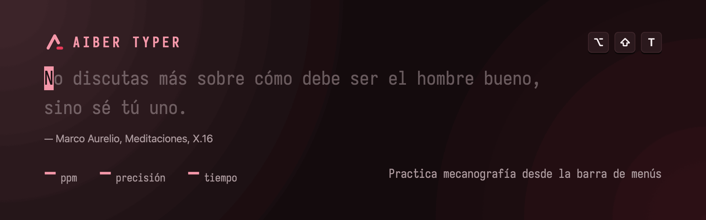
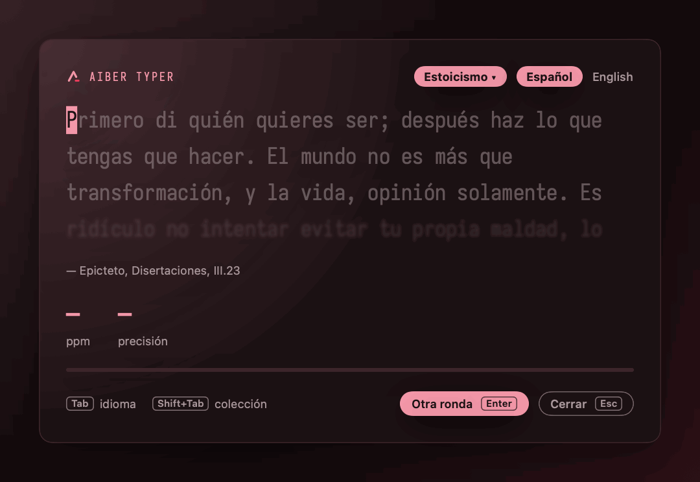
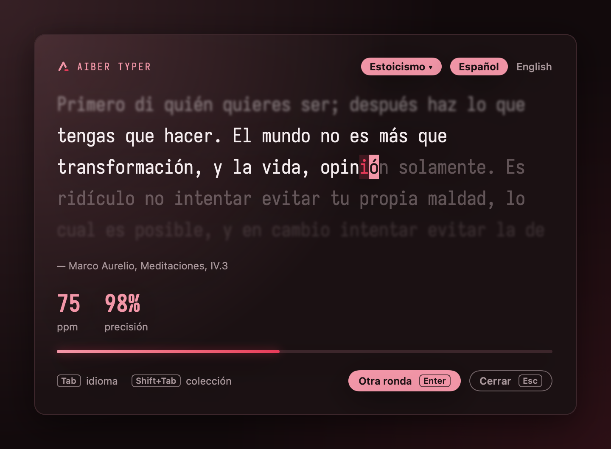
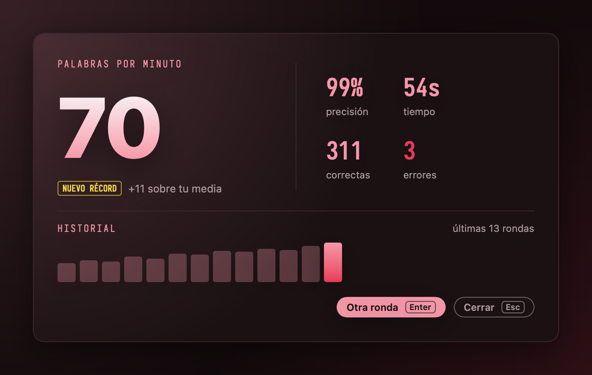
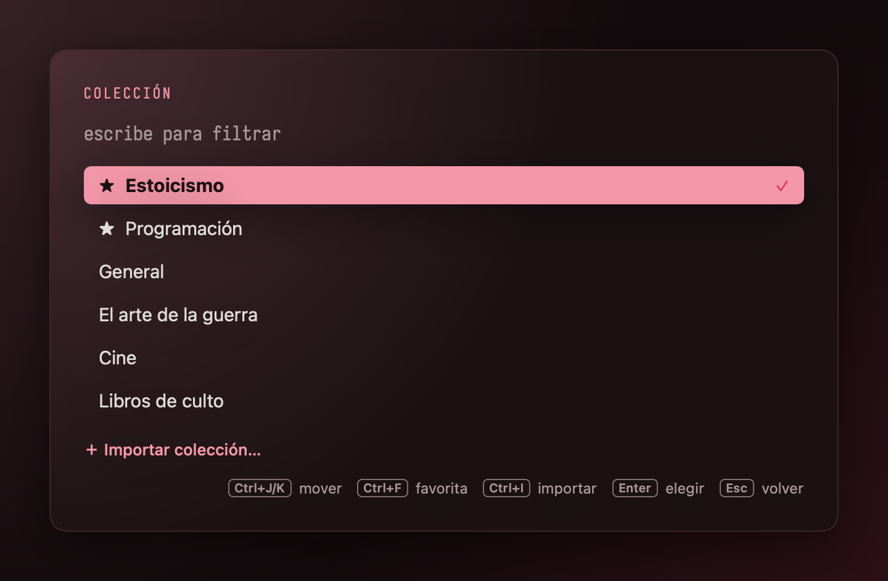

<a id="top"></a>

<div align="center">



<p><strong>Práctica de mecanografía en la barra de menús de tu Mac o en la bandeja de Windows.</strong><br/>
Pulsa <kbd>⌥</kbd> <kbd>⇧</kbd> <kbd>T</kbd> (<kbd>Alt+Shift+T</kbd> en Windows) desde cualquier sitio, escribe una cita y mira tus palabras por minuto y tu precisión. Luego, vuelve al trabajo.</p>

<p>
<a href="https://github.com/AitorBermeRuiz/AitorTyper/releases"></a>
<a href="https://github.com/AitorBermeRuiz/AitorTyper/actions/workflows/ci.yml"></a>


<a href="LICENSE"></a>
</p>

<p>
<a href="#instalación"><strong>Instalación</strong></a> &bull;
<a href="#cómo-funciona"><strong>Cómo funciona</strong></a> &bull;
<a href="#atajos"><strong>Atajos</strong></a> &bull;
<a href="#tus-propias-colecciones"><strong>Tus colecciones</strong></a> &bull;
<a href="#compilar-desde-el-código"><strong>Compilar</strong></a>
</p>

<p><a href="README.md">English</a> &bull; <strong>Español</strong></p>

</div>

---

Las webs de mecanografía piden una pestaña, una cuenta y tu atención. **Aiber Typer** es un panel flotante a un atajo de distancia: una ronda de 30 a 60 segundos entre dos tareas, puntuada con honestidad, y fuera con <kbd>Esc</kbd>. Sin icono en el Dock ni en la barra de tareas, sin cuenta, sin red.

<div align="center">

<br/><sub>Una ronda real, escrita en tiempo real y renderizada con las vistas de la propia app.</sub>
</div>

## Características

- **Un atajo, en cualquier app.** <kbd>⌥⇧T</kbd> abre el panel encima de lo que estés usando y <kbd>Esc</kbd> te devuelve donde estabas. Puedes cambiar el atajo desde la barra de menús.
- **Rondas a tu medida.** Cada ronda elige citas enteras para llenar de 30 a 60 segundos a tu velocidad reciente, así que nunca se hace larga.
- **Puntuación honesta.** Las ppm cuentan solo los caracteres correctos. La precisión cuenta cada pulsación, incluidos los errores que corregiste.
- **Escribe como un campo de texto normal.** Los acentos y las teclas muertas (´ + a → á, ñ) se componen como siempre: el español es de primera.
- **Citas que merece la pena escribir.** Seis colecciones incluidas, en español e inglés, y cada cita temática con su fuente.
- **Tu historial.** Cada ronda terminada se guarda en tu Mac; la pantalla de resultados muestra tu récord, cómo vas frente a tu media y tus últimas 20 rondas.
- **Tus propios textos.** Importa cualquier colección en JSON y marca tus favoritas.

<table>
<tr>
<td width="50%"></td>
<td width="50%"></td>
</tr>
<tr>
<td align="center"><sub><strong>Escribe.</strong> Los errores siguen en rojo hasta que los corriges.</sub></td>
<td align="center"><sub><strong>Puntúa.</strong> Récords, tu media y tu evolución.</sub></td>
</tr>
</table>

## Instalación

### macOS

En el Terminal (macOS 14 Sonoma o posterior):

```sh
curl -fsSL https://raw.githubusercontent.com/AitorBermeRuiz/AitorTyper/main/install/install.sh | bash
```

Descarga la última versión en Aplicaciones y la abre. Vuelve a ejecutarlo para actualizar.

Después, pulsa <kbd>⌥⇧T</kbd>. La app vive en la barra de menús (el icono con el logo de Aiber), no en el Dock.

<details>
<summary><b>Con Homebrew</b></summary>

```sh
brew trust --cask aitorbermeruiz/tap/aibertyper
brew install --cask aitorbermeruiz/tap/aibertyper
```

Desde Homebrew 6, los casks de taps de terceros solo se cargan después de confiar en ellos, una vez. Si la instalaste antes como `aitortyper`, `brew update` la pasa a `aibertyper`, y tu historial, tus colecciones y tus ajustes se conservan.

</details>

<details>
<summary><b>A mano</b></summary>

Descarga `AiberTyper-<versión>.zip` desde [Releases](https://github.com/AitorBermeRuiz/AitorTyper/releases), descomprímelo y mueve `AiberTyper.app` a Aplicaciones. Las compilaciones aún no están notarizadas por Apple, así que una app descargada con el navegador necesita esto una vez antes de abrirse (el script y Homebrew lo hacen por ti):

```sh
xattr -dr com.apple.quarantine /Applications/AiberTyper.app
```

</details>

### Windows

En PowerShell (Windows 10 u 11), sin permisos de administrador:

```powershell
irm https://raw.githubusercontent.com/AitorBermeRuiz/AitorTyper/main/install/install.ps1 | iex
```

Instala la última versión solo para tu usuario, en `%LOCALAPPDATA%\Programs\AiberTyper`, añade **Aiber Typer** al menú Inicio y la abre. Vuelve a ejecutarlo para actualizar.

Después, pulsa <kbd>Alt+Shift+T</kbd>. La app vive en el área de notificación (la bandeja), no en la barra de tareas; Windows puede esconder su icono bajo la flecha <kbd>^</kbd>.

<details>
<summary><b>Desinstalar, abrir al iniciar sesión, a mano</b></summary>

- Desinstalar (tu historial y tus colecciones se quedan): `& ([scriptblock]::Create((irm https://raw.githubusercontent.com/AitorBermeRuiz/AitorTyper/main/install/install.ps1))) -Uninstall`
- Para abrirla al iniciar sesión, pon un acceso directo a `%LOCALAPPDATA%\Programs\AiberTyper\AiberTyper.exe` en `shell:startup`.
- A mano: descarga `AiberTyper-<versión>-windows-x64.zip` desde [Releases](https://github.com/AitorBermeRuiz/AitorTyper/releases), descomprímelo donde quieras y ejecuta `AiberTyper.exe`. Aún no está firmada, así que SmartScreen puede avisar de un archivo descargado con el navegador: **Más información** → **Ejecutar de todas formas**.
- Es una app de 64 bits (x64) de unos 3 MB, sin nada más que instalar. Windows 11 en ARM la ejecuta con su emulación x64.

</details>

> [!TIP]
> El texto usa [IosevkaTerm Nerd Font](https://github.com/ryanoasis/nerd-fonts) si está instalada y, si no, la fuente monoespaciada del sistema (Cascadia Mono o Consolas en Windows).

## Cómo funciona

| | |
|---|---|
| **Ronda** | Un intento con un texto hecho de citas enteras, de unos 30 a 60 segundos a tus ppm recientes (40 la primera vez), nunca más de 90. |
| **ppm** | Caracteres correctos por minuto, divididos entre cinco. Los errores no suman, ni siquiera los corregidos. |
| **Precisión** | La proporción de pulsaciones acertadas, contando los errores que corregiste después. |
| **ppm recientes** | La media de tus últimas 10 rondas, en cualquier idioma. Decide la duración de la siguiente ronda. |
| **Récord** | Una ronda que supera a todas las anteriores. Te llevas la etiqueta <code>NUEVO RÉCORD</code>. |

La interfaz está en español. Las citas, en español o en inglés: <kbd>Tab</kbd> cambia de idioma.

### Colecciones incluidas

| Colección | Qué escribes |
|---|---|
| **General** | Frases cotidianas, para calentar |
| **Estoicismo** | Marco Aurelio, Séneca, Epicteto |
| **Programación** | Citas de quienes dieron forma al software |
| **El arte de la guerra** | Sun Tzu |
| **Cine** | Frases de películas |
| **Libros de culto** | Libros de culto |

Cada colección temática tiene al menos 30 citas en cada idioma, todas con una fuente verificable que se muestra bajo el texto.

## Atajos

| Tecla | Acción |
|-------|--------|
| <kbd>⌥⇧T</kbd><br/><kbd>Alt+Shift+T</kbd> en Windows | Abrir / cerrar (cámbialo con **Cambiar atajo…** en la barra de menús o en el menú de la bandeja). En macOS debe incluir ⌘, ⌥ o ⌃, y se rechaza ⌘+letra o ⌘+número (con o sin ⇧) porque las apps los usan, igual que ⌥ más cualquier tecla que escriba un carácter, como ⌥+letra o ⌥+ (`]` en un teclado español). En Windows debe incluir Ctrl, Alt o Win, y se rechaza Ctrl+letra o Ctrl+número (con o sin Shift), igual que Alt con una tecla que escribe (la usan los menús) y Ctrl+Alt con una tecla que escribe (Ctrl+Alt es AltGr: `@`, `€`, `#` en un teclado español), además de los atajos de ventanas Ctrl o Alt con Tab, Esc o F4, y Alt+Espacio. |
| <kbd>Tab</kbd> | Cambiar de idioma (Español / English) |
| <kbd>⇧Tab</kbd> | Elegir una colección |
| <kbd>Enter</kbd> | Nueva ronda |
| <kbd>Esc</kbd> | Cerrar |



En el selector de colecciones:

- escribe para filtrar (sin distinguir mayúsculas ni acentos)
- <kbd>Ctrl+J</kbd>/<kbd>Ctrl+K</kbd> o <kbd>↑</kbd><kbd>↓</kbd> para moverte
- <kbd>Ctrl+F</kbd> para marcar una favorita (las favoritas salen primero, con ★)
- <kbd>Ctrl+I</kbd> o el botón **＋ Importar colección…** para importar
- <kbd>Enter</kbd> para elegir, <kbd>Esc</kbd> para volver

Mientras escribes, <kbd>⌥⌫</kbd> (<kbd>Ctrl+Retroceso</kbd> en Windows) borra la última palabra, como en cualquier campo de texto.

Los botones **Otra ronda** y **Cerrar**, las píldoras de idioma y de colección y las filas del selector también admiten clic.

<br clear="right"/>

## Tus propias colecciones

Una colección es un archivo JSON:

```json
{
  "name": "Programación",
  "quotes": [
    {"text": "Simplicity is prerequisite for reliability.", "source": "Edsger W. Dijkstra"},
    {"text": "Una frase sin fuente."}
  ]
}
```

- `name` es obligatorio; es lo que muestra el selector.
- Cada cita necesita `text`; `source` es opcional y se muestra bajo el texto.
- Las frases de más de 300 caracteres (90 s a 40 ppm) o vacías se omiten.
- Los grupos de espacios en blanco (saltos de línea, tabuladores) se convierten en un solo espacio.
- Las frases con emoji o caracteres anchos (chino, japonés, coreano) se omiten.
- Los archivos de más de 1 MB se rechazan al importar y se ignoran en la carpeta.
- Tus colecciones no tienen idioma: se usan las mismas frases sea cual sea la pestaña elegida.

Los archivos viven en `~/Library/Application Support/AiberTyper/Colecciones`. Desde el icono de la barra de menús:

- **Importar colección…** (también en el selector) explica primero el formato (con la casilla "No volver a mostrar este mensaje nunca más"), luego comprueba los archivos que elijas y copia los válidos en esa carpeta. Si ya existe un archivo con el mismo nombre, se mueve a la Papelera (la Papelera de reciclaje en Windows) antes de escribir el nuevo; reimportar un archivo de la propia carpeta es seguro.
- **Abrir carpeta de colecciones** abre la carpeta para editar o borrar archivos a mano. Los cambios aparecen la próxima vez que abras el selector.

Mira [`Examples/Programming.json`](Examples/Programming.json) para un ejemplo listo para importar.

## Tus datos

Todo se queda en tu ordenador. La app no hace ninguna petición de red.

| Qué | Dónde |
|---|---|
| Rondas terminadas | `~/Library/Application Support/AiberTyper/history.json` |
| Tus colecciones | `~/Library/Application Support/AiberTyper/Colecciones/` |
| Idioma, colección, favoritas, atajo | `defaults read com.aiber.AiberTyper` |

`brew uninstall --zap aibertyper` lo borra todo. Sin Homebrew, borra la app y las rutas de arriba.

En Windows los mismos archivos viven en `%APPDATA%\AiberTyper`: `history.json`, `Colecciones\` y `settings.json` (idioma, colección, favoritas, atajo). `history.json` tiene el mismo formato en los dos sistemas, así que puedes copiarlo de un ordenador a otro. Desinstalar conserva esta carpeta; bórrala para eliminar tus datos.

## Compilar desde el código

Basta con Swift 5.10 y las Command Line Tools; no hay dependencias.

```sh
./test.sh    # autocomprobación, debe imprimir "self-check OK"
./build.sh   # genera build/AiberTyper.app (UNIVERSAL=1 para arm64 + x86_64)
open build/AiberTyper.app
```

La app de Windows está en [`windows/`](windows): Go, sin dependencias, Win32 y GDI+ (sin vista web). Se compila desde macOS, Linux o Windows:

```sh
windows/build.sh                # genera build/windows/AiberTyper.exe
(cd windows && go test ./...)   # sus tests, incluidos los vectores exportados del código Swift
```

El código Swift es la referencia de las dos apps. `scripts/export-shared.sh` exporta de él las colecciones incluidas y los vectores de test a `windows/shared`, y el CI falla cuando están desactualizados o cuando el port en Go no coincide con ellos.

`scripts/readme-assets.sh` renderiza el banner, las capturas y los GIF de [`docs/assets`](docs/assets) con las vistas reales de la app. Las notas para contribuir están en [`AGENTS.md`](AGENTS.md), el vocabulario en [`GLOSSARY.md`](GLOSSARY.md) y el trabajo previsto en [`ROADMAP.md`](ROADMAP.md) (en inglés).

<details>
<summary><b>Publicar una versión</b></summary>

Sube una etiqueta como `v0.2.0` sobre `main` (`git tag -a v0.2.0 origin/main -m "AiberTyper 0.2.0" && git push origin v0.2.0`, o **Draft a new release** con destino `main`); las etiquetas sobre cualquier otro commit se rechazan. El [workflow de release](.github/workflows/release.yml) ejecuta la autocomprobación, compila una app universal, publica `AiberTyper-0.2.0.zip` y `AiberTyper-0.2.0-windows-x64.zip` en GitHub Releases y actualiza el cask en [AitorBermeRuiz/homebrew-tap](https://github.com/AitorBermeRuiz/homebrew-tap).

Secretos del repositorio que lee (todos opcionales):

| Secreto | Para qué |
|---------|----------|
| `HOMEBREW_TAP_TOKEN` | Token fine-grained con *Contents: read and write* sobre `homebrew-tap`; sin él no se actualiza el tap. |
| `MACOS_CERT_P12`, `MACOS_CERT_PASSWORD`, `MACOS_SIGN_IDENTITY` | Certificado Developer ID Application (`.p12` en base64), su contraseña y su nombre. Sin ellos la app se firma ad hoc. |
| `NOTARY_APPLE_ID`, `NOTARY_TEAM_ID`, `NOTARY_PASSWORD` | Apple ID, team id y contraseña específica de app para la notarización (necesita también los secretos del certificado; los tres o ninguno). Una vez configurados, el cask deja de quitar la marca de cuarentena. |

</details>

## Licencia

[MIT](LICENSE). Las skills de agente en `.agents/skills/` mantienen sus propias licencias MIT.

<div align="center">
<br/>

<br/>
<sub>Un producto <strong>Aiber</strong> · <a href="#top">volver arriba ↑</a></sub>
</div>
