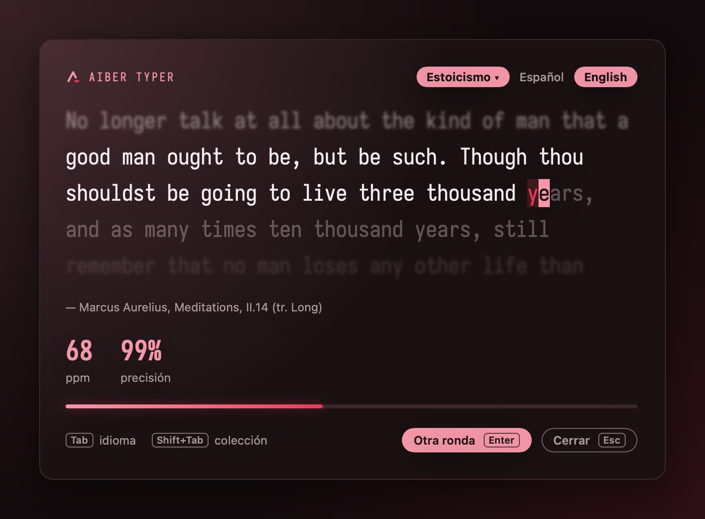

<a id="top"></a>

<div align="center">


<p><strong>Typing practice that lives in your Mac's menu bar.</strong><br/>
Press <kbd>⌥</kbd> <kbd>⇧</kbd> <kbd>T</kbd> anywhere, type a quote, see your words per minute and accuracy. Then get back to work.</p>

<p>
<a href="https://github.com/AitorBermeRuiz/AitorTyper/releases"></a>
<a href="https://github.com/AitorBermeRuiz/AitorTyper/actions/workflows/ci.yml"></a>


<a href="LICENSE"></a>
</p>

<p>
<a href="#install"><strong>Install</strong></a> &bull;
<a href="#how-it-works"><strong>How it works</strong></a> &bull;
<a href="#shortcuts"><strong>Shortcuts</strong></a> &bull;
<a href="#your-own-collections"><strong>Your own collections</strong></a> &bull;
<a href="#build-from-source"><strong>Build</strong></a>
</p>

<p><strong>English</strong> &bull; <a href="README.es.md">Español</a></p>

</div>

---

Typing websites want a tab, an account and your attention. **Aiber Typer** is a floating panel one shortcut away: a 30 to 60 second round between two tasks, scored the honest way, and gone with <kbd>Esc</kbd>. No Dock icon, no account, no network.

<div align="center">

<br/><sub>A real round, typed in real time and rendered from the app's own views.</sub>
</div>

## Features

- **One shortcut, anywhere.** <kbd>⌥⇧T</kbd> opens the panel over any app and <kbd>Esc</kbd> sends you back where you were. Change the shortcut from the menu bar.
- **Rounds sized to you.** Each round picks whole quotes to fill 30 to 60 seconds at your recent speed, so it never drags.
- **Honest score.** WPM counts only correct characters. Accuracy counts every keystroke, even the mistakes you fixed.
- **Types like a real text field.** Accents and dead keys (´ + a → á, ñ) compose as usual, so Spanish is first class.
- **Quotes worth typing.** Six built-in collections in Spanish and English, every themed quote with its source.
- **Your history.** Each finished round is saved locally; the results screen shows your record, how you compare to your average and your last 20 rounds.
- **Bring your own texts.** Import any JSON collection and star your favorites.

<table>
<tr>
<td width="50%"></td>
<td width="50%"></td>
</tr>
<tr>
<td align="center"><sub><strong>Type.</strong> Mistakes stay red until you fix them.</sub></td>
<td align="center"><sub><strong>Score.</strong> Records, your average and your trend.</sub></td>
</tr>
</table>

## Install

In Terminal (macOS 14 Sonoma or later):

```sh
curl -fsSL https://raw.githubusercontent.com/AitorBermeRuiz/AitorTyper/main/scripts/install.sh | bash
```

It downloads the latest release to Applications and opens it. Run it again to update.

Then press <kbd>⌥⇧T</kbd>. The app lives in the menu bar (the Aiber logo icon), not in the Dock.

<details>
<summary><b>With Homebrew</b></summary>

```sh
brew trust --cask aitorbermeruiz/tap/aibertyper
brew install --cask aitorbermeruiz/tap/aibertyper
```

Homebrew 6 and later load casks from third-party taps only after you trust them, once. If you installed it before as `aitortyper`, `brew update` moves it to `aibertyper`, and your history, collections and settings carry over.

</details>

<details>
<summary><b>By hand</b></summary>

Download `AiberTyper-<version>.zip` from [Releases](https://github.com/AitorBermeRuiz/AitorTyper/releases), unzip it and move `AiberTyper.app` to Applications. Builds are not notarized by Apple yet, so an app downloaded with a browser needs this once before it opens (the script and Homebrew do it for you):

```sh
xattr -dr com.apple.quarantine /Applications/AiberTyper.app
```

</details>

> [!TIP]
> The text uses [IosevkaTerm Nerd Font](https://github.com/ryanoasis/nerd-fonts) when it is installed, and the system monospaced font otherwise.

## How it works

| | |
|---|---|
| **Round** | One go at a text made of whole quotes, about 30 to 60 seconds at your recent WPM (40 on the first run), never more than 90. |
| **WPM** | Correct characters per minute, divided by five. Mistakes add nothing, even corrected ones. |
| **Accuracy** | The share of keystrokes that were right, counting mistakes you later fixed. |
| **Recent WPM** | The average of your last 10 rounds, in any language. It sets the length of the next round. |
| **Record** | A round that beats every earlier one. You get a <code>NUEVO RÉCORD</code> badge. |

The interface is in Spanish. The quotes come in Spanish or English: <kbd>Tab</kbd> switches.

### Built-in collections

| Collection | What you type |
|---|---|
| **General** | Everyday sentences, good for warming up |
| **Estoicismo** | Marcus Aurelius, Seneca, Epictetus |
| **Programación** | Quotes from people who shaped software |
| **El arte de la guerra** | Sun Tzu |
| **Cine** | Lines from films |
| **Libros de culto** | Cult books |

Every themed collection has at least 30 quotes in each language, each with a verifiable source shown under the text.

## Shortcuts

| Key | Action |
|-----|--------|
| <kbd>⌥⇧T</kbd> | Open / close (change it with **Cambiar atajo…** in the menu bar; it must include ⌘, ⌥ or ⌃, and ⌘+letter or ⌘+number (with or without ⇧) is refused because apps use it, as is ⌥ plus any key that types a character, such as ⌥+letter or ⌥+ (`]` on a Spanish keyboard)) |
| <kbd>Tab</kbd> | Switch language (Español / English) |
| <kbd>⇧Tab</kbd> | Choose a collection |
| <kbd>Enter</kbd> | New round |
| <kbd>Esc</kbd> | Close |


In the collection picker:

- type to filter (case and accent insensitive)
- <kbd>Ctrl+J</kbd>/<kbd>Ctrl+K</kbd> or <kbd>↑</kbd><kbd>↓</kbd> to move
- <kbd>Ctrl+F</kbd> to star a favorite (favorites are listed first, with ★)
- <kbd>Ctrl+I</kbd> or the **＋ Importar colección…** button to import
- <kbd>Enter</kbd> to choose, <kbd>Esc</kbd> to go back

The **Otra ronda** and **Cerrar** buttons, the language and collection pills and the picker rows can also be clicked.

<br clear="right"/>

## Your own collections

A collection is a JSON file:

```json
{
  "name": "Programación",
  "quotes": [
    {"text": "Simplicity is prerequisite for reliability.", "source": "Edsger W. Dijkstra"},
    {"text": "Una frase sin fuente."}
  ]
}
```

- `name` is required; it is what the picker shows.
- Each quote needs `text`; `source` is optional and shown under the text.
- Sentences over 300 characters (90 s at 40 wpm) or empty are skipped.
- Whitespace runs (line breaks, tabs) become one space.
- Sentences with emoji or wide characters (Chinese, Japanese, Korean) are skipped.
- Files over 1 MB are refused on import and ignored in the folder.
- Your collections have no language: the same sentences are used whatever tab selects.

Files live in `~/Library/Application Support/AiberTyper/Colecciones`. From the menu-bar icon:

- **Importar colección…** (also in the picker) first explains the format (with a "No volver a mostrar este mensaje nunca más" checkbox), then checks the files you pick and copies the valid ones into that folder. An existing file with the same name is moved to the Trash before the new one is written; re-importing a file from the folder itself is safe.
- **Abrir carpeta de colecciones** opens the folder, to edit or delete files by hand. Changes show up the next time you open the picker.

See [`Examples/Programming.json`](Examples/Programming.json) for a ready-to-import example.

## Your data

Everything stays on your Mac. The app makes no network requests.

| What | Where |
|---|---|
| Finished rounds | `~/Library/Application Support/AiberTyper/history.json` |
| Your collections | `~/Library/Application Support/AiberTyper/Colecciones/` |
| Language, collection, favorites, shortcut | `defaults read com.aiber.AiberTyper` |

`brew uninstall --zap aibertyper` removes all of it. Without Homebrew, delete the app and the paths above.

## Build from source

Swift 5.10 and the Command Line Tools are enough; there are no dependencies.

```sh
./test.sh    # self-check, must print "self-check OK"
./build.sh   # builds build/AiberTyper.app (UNIVERSAL=1 for arm64 + x86_64)
open build/AiberTyper.app
```

`scripts/readme-assets.sh` renders the banner, screenshots and demo GIFs in [`docs/assets`](docs/assets) from the app's real views. Contributor notes are in [`AGENTS.md`](AGENTS.md), the vocabulary in [`GLOSSARY.md`](GLOSSARY.md) and planned work in [`ROADMAP.md`](ROADMAP.md).

<details>
<summary><b>Releasing</b></summary>

Push a tag such as `v0.2.0` on `main` (`git tag -a v0.2.0 origin/main -m "AiberTyper 0.2.0" && git push origin v0.2.0`, or **Draft a new release** with target `main`); tags on any other commit are refused. The [release workflow](.github/workflows/release.yml) runs the self-check, builds a universal app, publishes `AiberTyper-0.2.0.zip` on GitHub Releases and updates the cask in [AitorBermeRuiz/homebrew-tap](https://github.com/AitorBermeRuiz/homebrew-tap).

Repository secrets it reads (all optional):

| Secret | Purpose |
|--------|---------|
| `HOMEBREW_TAP_TOKEN` | Fine-grained token with *Contents: read and write* on `homebrew-tap`; without it the tap is not updated. |
| `MACOS_CERT_P12`, `MACOS_CERT_PASSWORD`, `MACOS_SIGN_IDENTITY` | Developer ID Application certificate (base64 `.p12`), its password and its name. Without them the app is ad-hoc signed. |
| `NOTARY_APPLE_ID`, `NOTARY_TEAM_ID`, `NOTARY_PASSWORD` | Apple ID, team id and app-specific password for notarization (needs the certificate secrets too; all three or none). Once set, the cask stops removing the quarantine flag. |

</details>

## License

[MIT](LICENSE). The agent skills under `.agents/skills/` keep their own MIT licenses.

<div align="center">
<br/>

<br/>
<sub>An <strong>Aiber</strong> product · <a href="#top">back to top ↑</a></sub>
</div>
